# INTERLOCK

**PLC Safety Logic Integrity & Impact Analyzer. INTERLOCK turns PLC project changes into safety-impact evidence.**

A diff of two PLC exports tells you which rungs changed. INTERLOCK answers the question a reviewer actually has to sign off on: *did this change alter a safety function, where does the change propagate, and could it stop the system from shutting down or from notifying an operator?* It executes one controller scan of each export symbolically, compares the firing condition of every declared protective output and alarm across every input combination, proves which new term inhibits a trip, follows a modified Add-On Instruction to every instance that runs it, and ranks what needs review, with the exact before/after logic, file hashes and XML locations behind every conclusion. It reads exported project files only and never connects to a controller.

<p align="center"></p>

**Try it:** the workstation runs entirely in your browser (no upload, no server) — [het-p301204.github.io/interlock](https://het-p301204.github.io/interlock/) → *Explore Demo*. Or run it locally in two commands (see [Installation](#10-installation)).

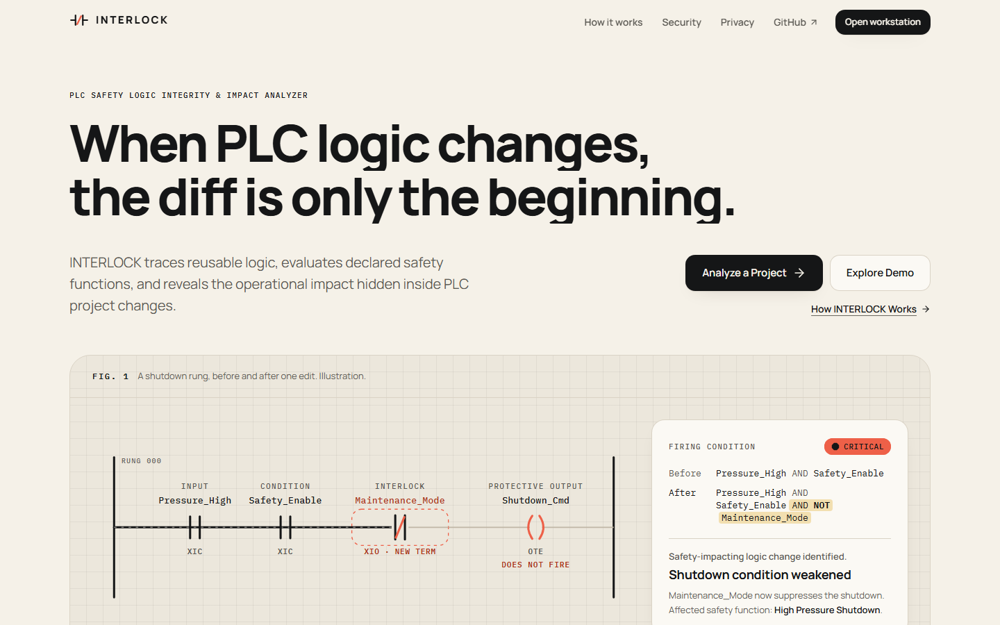

### Impact review
One AOI definition changed. INTERLOCK follows it to 5 instances, finds 3 that carry declared safety functions, proves the new term is an inhibit, and still refuses to call the 2 undeclared instances safe.

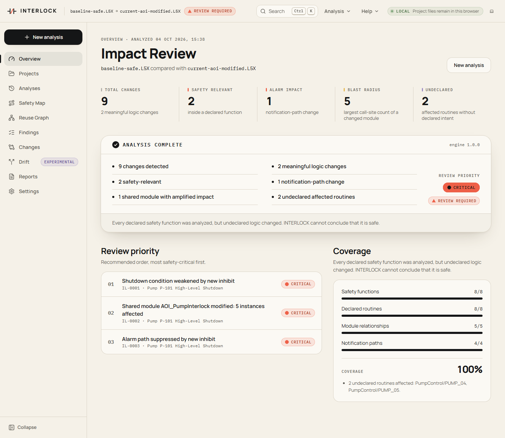

### Finding detail: the firing condition, before and after
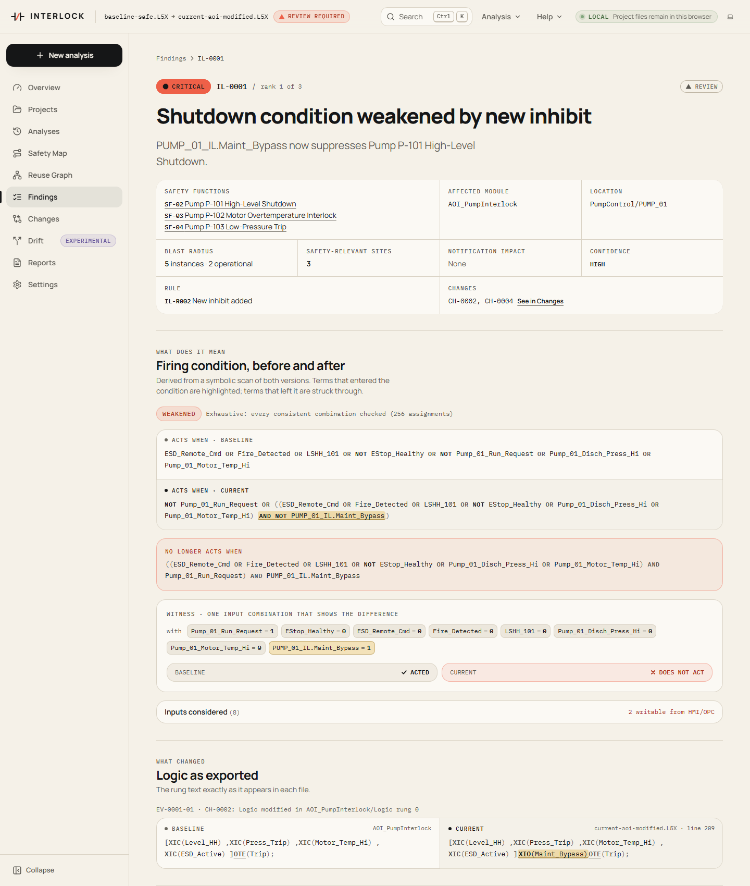

<table>
<tr>
<td width="50%"><b>Reuse graph</b> — one definition, every call site, every protective output it feeds<br>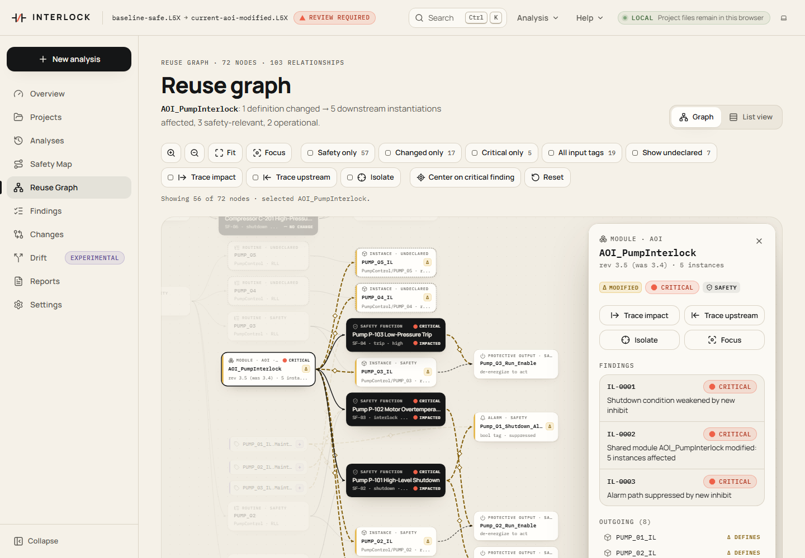</td>
<td width="50%"><b>Safety map</b> — each declared function from implementation to protective output and alarm<br>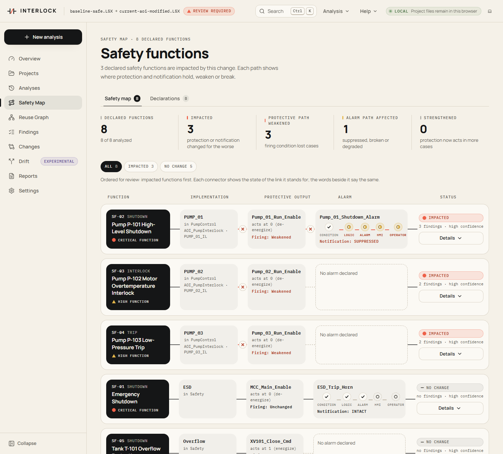</td>
</tr>
<tr>
<td><b>Evidence ledger</b> — file, SHA-256, XML path, line, rule, timestamp<br>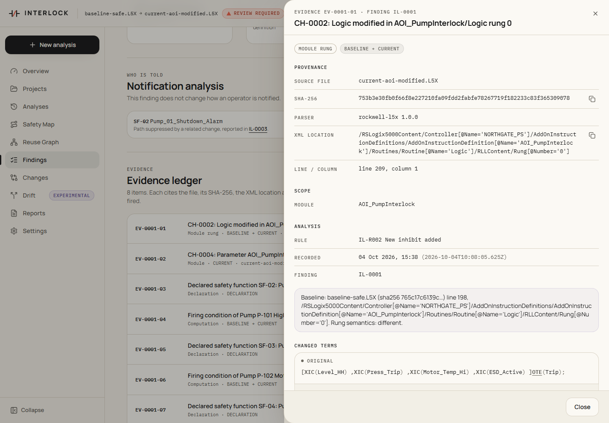</td>
<td><b>Review-surface reduction</b> — 425 changes in a noisy export, 2 that matter<br>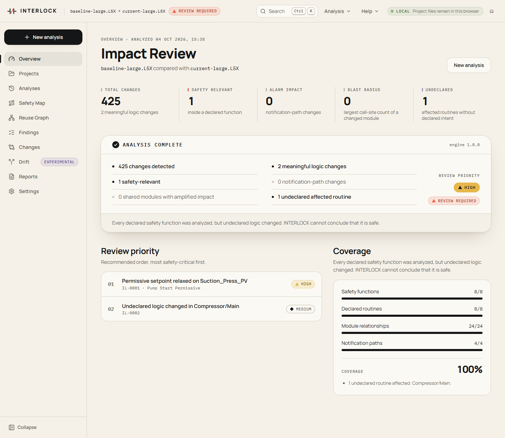</td>
</tr>
<tr>
<td><b>Analysis pipeline</b> — ten stages, each reporting what it actually did<br>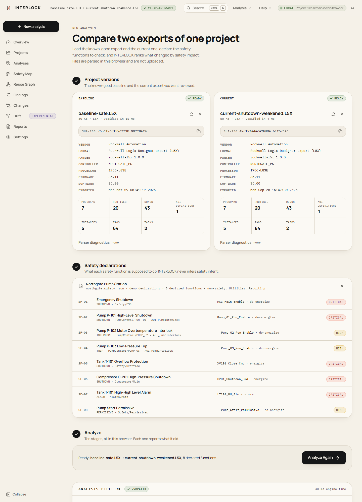</td>
<td><b>Cross-site module drift</b> (experimental) — same AOI name, different behaviour<br>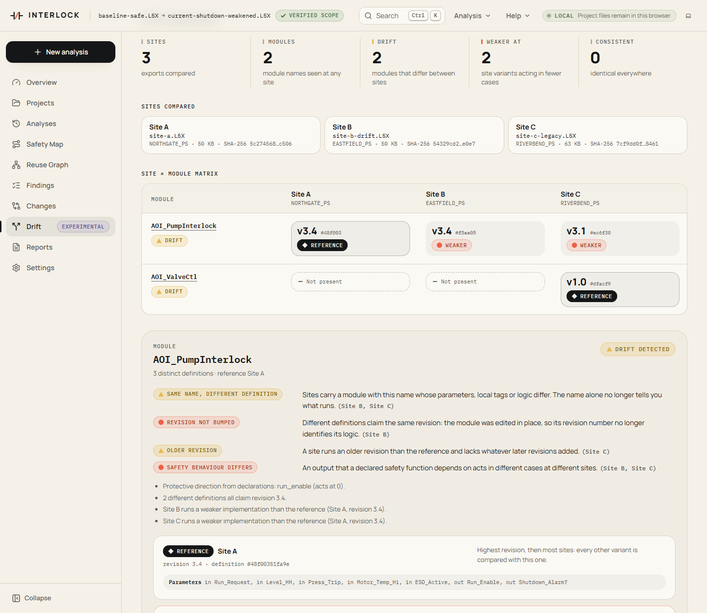</td>
</tr>
<tr>
<td><b>Dark mode</b> — graphite, never black-and-neon<br>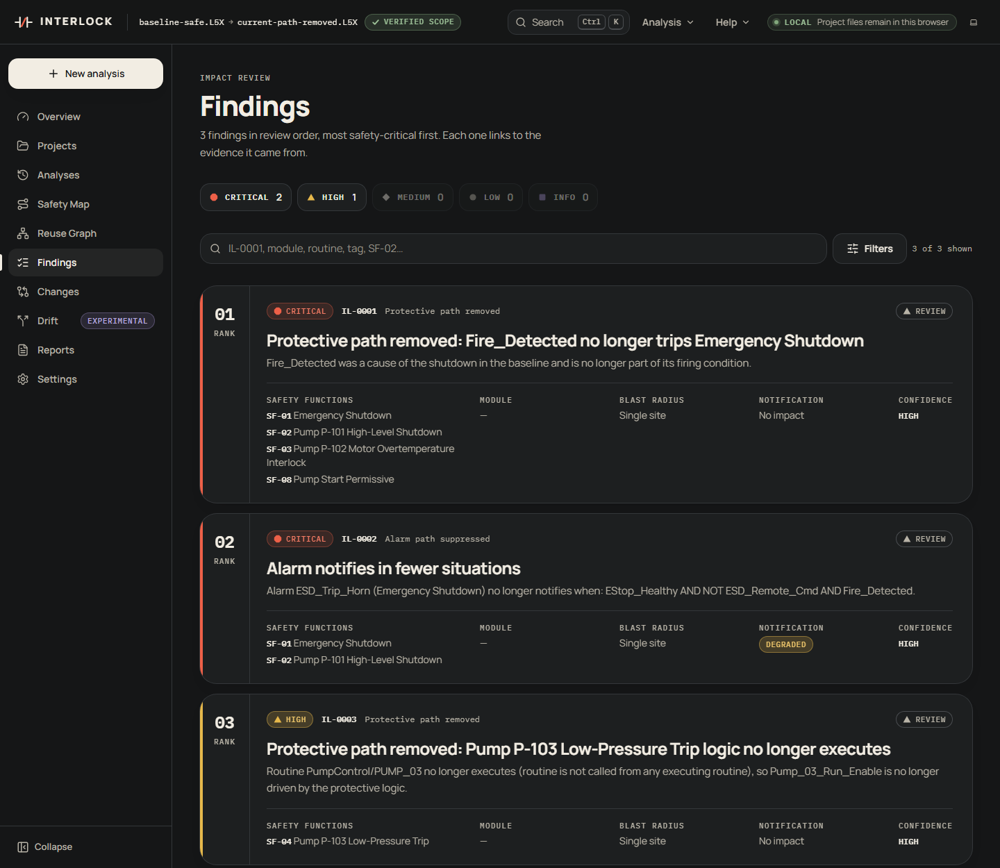</td>
<td><b>Phone</b> — stacked cards and a list view instead of a cramped graph<br>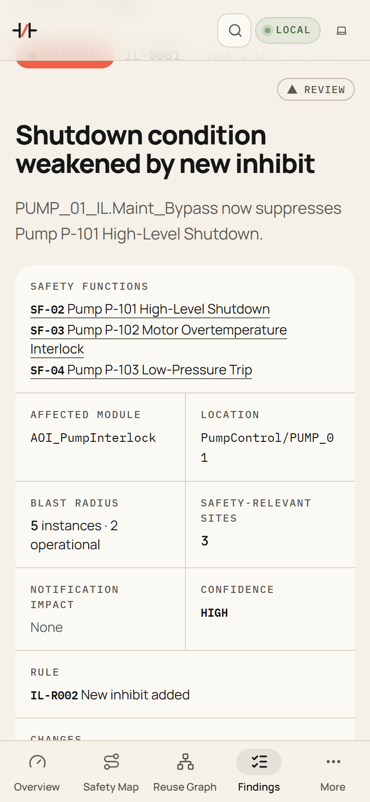</td>
</tr>
</table>

All screenshots are of the real app analyzing the synthetic Northgate fixtures, captured by `node scripts/screenshots.ts`.

## Contents

1. [What INTERLOCK is](#1-what-interlock-is)
2. [Why it exists](#2-why-it-exists)
3. [The problem with conventional PLC diffs](#3-the-problem-with-conventional-plc-diffs)
4. [Core concepts](#4-core-concepts)
5. [Supported formats](#5-supported-formats)
6. [Architecture](#6-architecture)
7. [Safety-function model](#7-safety-function-model)
8. [Reuse graph](#8-reuse-graph)
9. [Analysis methodology](#9-analysis-methodology)
10. [Installation](#10-installation)
11. [Development](#11-development)
12. [Demo](#12-demo)
13. [Tests](#13-tests)
14. [Limitations](#14-limitations)
15. [Security model](#15-security-model)
16. [Roadmap](#16-roadmap)

## 1. What INTERLOCK is

A deterministic analysis engine with three front ends:

- **A review workstation** in the browser. The engine runs in a Web Worker: in its default LOCAL mode project files never leave the browser, so it works as a static site (GitHub Pages at https://het-p301204.github.io/interlock/ when deployed).
- **A REST API** for teams, which stores project versions and analyses in SQLite and runs every analysis in a worker thread with a timeout and a memory cap.
- **A command line** for CI, with text, JSON, Markdown, CSV, PDF and SARIF output and an exit code that gates a merge on safety-relevant findings.

You give it a known-good export (the baseline), the proposed export (the current version) and a short JSON file declaring the plant's safety functions. It gives you a ranked set of findings, each with a severity, a confidence, the affected safety functions, the blast radius through shared modules, the effect on operator notification, a plain-language explanation, review guidance and an evidence ledger. No language model decides anything: every conclusion is computed, and the same inputs always produce the same result.

Rockwell Logix Designer L5X is supported today. PLCopen XML, Siemens TIA Openness XML and Schneider XEF are recognized and declined as PLANNED.

## 2. Why it exists

Industrial controllers carry the logic that stops a pump on high level, trips a compressor on high pressure and tells the control room something is wrong. That logic changes for good reasons (maintenance, new equipment, nuisance alarms) through management-of-change processes whose technical review step is usually a person reading a text diff of an export.

That review is hard to do well:

- Real exports are noisy. A maintenance export with three logic edits can carry hundreds of description and stored-value changes.
- Reusable blocks multiply a change. One edit inside an Add-On Instruction changes every pump that calls it, but the diff shows one rung.
- Safety behaviour is non-local. An output's trip condition is assembled from rungs in several routines, programs and tasks; scan order decides which write wins.
- Weakening is subtle. One added `XIO` contact, a moved setpoint, a deleted `JSR` or a new writer later in the scan can each defeat a trip without touching the trip rung.
- Alarms fail silently. A notification path can be cut while the shutdown still works, and nobody notices until the operator is not told.

INTERLOCK makes that step systematic, and it is honest about the part it cannot see: logic nobody declared as safety-relevant is reported as **UNDECLARED**, never as safe.

## 3. The problem with conventional PLC diffs

Scenario 02 of the synthetic fixtures changes one rung of the compressor program. A conventional diff shows this:

```diff
  Program Compressor / Routine Main / Rung 0
- XIC(PT201_High)XIC(Safety_Enable)OTE(C201_Shutdown_Cmd);
+ XIC(PT201_High)XIC(Safety_Enable)XIO(Maintenance_Mode)OTE(C201_Shutdown_Cmd);
```

One contact. Whether it matters depends on facts the diff does not show: that `C201_Shutdown_Cmd` is the energize-to-trip output of a CRITICAL shutdown, that no logic writes `Maintenance_Mode` and the HMI can, and that the shutdown alarm in another program is driven by the same output. INTERLOCK reports (real output):

```
IL-0001 CRITICAL  NEW_INHIBIT  [SF-06]  Shutdown condition weakened by new inhibit
Maintenance_Mode now suppresses Compressor C-201 High-Pressure Shutdown.
In the baseline, the shutdown acts (C201_Shutdown_Cmd = 1) when: PT201_High AND Safety_Enable.
In the current project, it acts when: PT201_High AND Safety_Enable AND NOT Maintenance_Mode.
The new term Maintenance_Mode is an inhibit: with Maintenance_Mode = 0 the current condition is exactly
the baseline condition, and with Maintenance_Mode = 1 the shutdown does not act. Proved over 8 input combinations.
No executing logic writes Maintenance_Mode; its value comes from outside the controller logic (an input, an HMI or another client).
Maintenance_Mode has external access Read/Write: an HMI or OPC client can set it.
Example: with PT201_High = 1, Safety_Enable = 1, Maintenance_Mode = 1, the shutdown acted in the baseline and does not act now.

IL-0002 CRITICAL  ALARM_SUPPRESSED  [SF-06]  Alarm path suppressed by new inhibit
Maintenance_Mode now suppresses alarm C201_Shutdown_Alm (Compressor C-201 High-Pressure Shutdown).
After: Condition → Logic (inhibited) → Alarm (inhibited) → HMI (inhibited) → Operator (inhibited).
```

The other seven declared functions are reported `NO_CHANGE`, and the evidence ledger cites both file hashes, the parser version and the rung's XML path and line.

## 4. Core concepts

**Safety function.** A protective behaviour the engineer declares in the safety manifest: a shutdown, trip, interlock, permissive or alarm, with its protective output, alarm, implementation and criticality. INTERLOCK never infers safety intent from code; every safety conclusion is relative to a declaration.

**Protective output and trip state.** The tag that acts on the equipment (a run enable, a trip command, a close-valve command) and the value it takes when the function acts: `DE_ENERGIZE` (acts at 0, fail-safe enables) or `ENERGIZE` (acts at 1, trip commands).

**Firing condition.** The boolean condition, over the scan's inputs, under which the function acts: `NOT output` for `DE_ENERGIZE`, `output` for `ENERGIZE`, taken from the end-of-scan value the symbolic scan computes. Intermediate bits, JSRs and AOI logic are expanded, so the condition names real inputs. Comparing the baseline and current firing conditions over every input combination gives `UNCHANGED`, `EQUIVALENT`, `WEAKENED`, `STRENGTHENED`, `MIXED`, `NEVER_FIRES`, `ALWAYS_FIRES` or `NOT_DECIDED`.

**Inhibit.** A new term `X` such that fixing `X` to one value restores the baseline condition exactly. Then the other value of `X` is what suppresses the function. INTERLOCK proves this by Shannon cofactor and exhaustive comparison; it never infers it from a tag name.

**Notification path.** `CONDITION → LOGIC → ALARM → HMI → OPERATOR` for each declared alarm. The first three stages come from the logic (including an ALMD's `ProgDisable` input); the HMI and operator stages come from the declaration and are shown as DECLARED because a project file cannot prove them. A path is `INTACT`, `DEGRADED` (notifies in fewer situations), `SUPPRESSED` (a proved inhibit), `BROKEN` (can no longer notify) or `NOT_ANALYZED`.

**Reuse graph and blast radius.** Which reusable definition affects which runtime call site: task → program → routine → instance ← module, with protective outputs, alarms and safety functions attached. The blast radius of a changed module is its instance count, split into safety-relevant (inside a declared function), operational (executes, nothing declared) and not executed.

**Dependency cone.** Everything the end-of-scan value of a protective output or alarm actually used: rungs, routines, programs, tasks, modules, instances and tags, recorded as provenance during the symbolic scan. A change inside a function's cone is that function's change.

**Undeclared logic.** Logic outside every declared cone and outside the declared non-safety scope. A change there is `UNDECLARED_LOGIC_CHANGED`: "No safety intent has been declared for this logic. INTERLOCK therefore cannot conclude that it is safe."

**Coverage and trust.** Coverage is four ratios (safety functions analyzed, declared routines analyzable, AOI call sites readable, notification paths analyzed) and their mean. Trust is `VERIFIED_SCOPE` (everything declared was analyzed and nothing undeclared changed), `REVIEW_REQUIRED` (undeclared logic changed) or `PARTIAL_COVERAGE` (something declared, or something executing, could not be fully analyzed). There is no status that means "secure".

## 5. Supported formats

| Format | Vendor | Status |
|---|---|---|
| Logix Designer export (`.L5X`) | Rockwell Automation | **SUPPORTED** |
| PLCopen XML (IEC 61131-3 TC6, `.xml`) | PLCopen | PLANNED: recognized and declined with `FORMAT_NOT_SUPPORTED` |
| TIA Portal Openness XML (`.xml`) | Siemens | PLANNED |
| EcoStruxure Control Expert / Unity Pro (`.xef`) | Schneider Electric | PLANNED |

Within L5X, ladder logic (RLL) is analyzed semantically. Structured text, FBD and SFC routines are **parsed structurally**: they are part of the project model, the structural diff and the reuse graph, but INTERLOCK does not interpret what they compute. For structured text, every assignment target (and the destination of `COP`, `CPS` and `MOV` calls) is recorded as an unanalyzed write, so an ST routine that writes a protective output still shows up as a writer. FBD and SFC diagrams are not read; when such a routine executes, the trust status is `PARTIAL_COVERAGE`. Source-protected routines and AOIs are kept with no logic and reported. Details: [docs/supported-formats.md](docs/supported-formats.md).

## 6. Architecture

```
   baseline.L5X   current.L5X   plant.safety.json
        │              │              │
        ▼              ▼              ▼
  ┌──────────────────────────────┐  ┌────────────────────┐
  │ INGEST  decode · SHA-256 ·   │  │ manifest validator │
  │ hardened XML · L5X adapter   │  │ (strict schema)    │
  └──────────────┬───────────────┘  └─────────┬──────────┘
                 ▼                            │
   NORMALIZE      case-insensitive index, rung parse
                 ▼                            │
   RESOLVE MODULES   AOI call sites → definitions
                 ▼                            │
   BUILD REUSE GRAPH   symbolic scan of each project
                 ▼                            ▼
   MAP SAFETY FUNCTIONS   resolve declarations in both projects
                 ▼
   COMPARE LOGIC   structural diff + per-rung equivalence proof
                 ▼
   TRACE PROTECTIVE PATHS   firing conditions, exhaustive comparison
                 ▼
   ANALYZE ALARMS   notification paths, suppressor proof
                 ▼
   RANK IMPACT   20 rules → effects → grouped, scored findings
                 ▼
   GENERATE REVIEW SET   coverage · trust · review surface · reuse graph
                 ▼
   AnalysisResult (interlock.analysis/v1) ──► web UI · API · CLI · JSON/CSV/MD/PDF/SARIF
```

Each stage reports what it actually did, with real counts; the web UI's analysis timeline shows only those reports. The engine reads no clock, generates no random numbers and has no I/O; ESLint enforces this, which is why the same code runs in a browser worker, a server worker thread and the CLI.

```
packages/core/src/
  model/      vendor-neutral project, safety and analysis types
  xml/        hardened, iterative XML tree builder (no DTD, ever)
  adapters/   ProjectAdapter interface, registry, l5x/
  logic/      rung parser, hash-consed boolean expressions, truth-table comparison
  analysis/   project index, symbolic scan, diff, safety analysis, rules/, findings, graph, drift, pipeline
  report/     one document model → Markdown and a dependency-free PDF writer; JSON, CSV
  util/       strict decoding, SHA-256, invisible-character stripping
apps/web      React 19 + Vite review workstation, engine in a Web Worker
apps/api      Hono + node:sqlite, engine in worker threads
apps/cli      CI command line
fixtures/     synthetic Northgate pump station: generator, exports, manifests, hand-written oracle
```

Full mapping of layers to modules, every modelling assumption and the determinism guarantees: [docs/architecture.md](docs/architecture.md).

## 7. Safety-function model

```json
{
  "schema": "interlock.safety/v1",
  "project": "Northgate Pump Station",
  "functions": [
    {
      "id": "SF-02",
      "name": "Pump P-101 High-Level Shutdown",
      "kind": "SHUTDOWN",
      "criticality": "CRITICAL",
      "implementation": { "program": "PumpControl", "routine": "PUMP_01", "module": "AOI_PumpInterlock", "instance": "PUMP_01_IL" },
      "protectiveOutput": { "tag": "Pump_01_Run_Enable", "tripState": "DE_ENERGIZE" },
      "alarm": { "tag": "Pump_01_Shutdown_Alarm", "notification": "HMI alarm summary, Control Room A" }
    },
    {
      "id": "SF-05",
      "name": "Tank T-101 Overflow Protection",
      "kind": "SHUTDOWN",
      "criticality": "CRITICAL",
      "implementation": { "program": "Safety", "routine": "Overflow" },
      "protectiveOutput": { "tag": "XV101_Close_Cmd", "tripState": "ENERGIZE" }
    }
  ],
  "nonSafetyScope": { "programs": ["Utilities", "Reporting"] }
}
```

`kind` is `SHUTDOWN`, `TRIP`, `INTERLOCK`, `PERMISSIVE` or `ALARM`; `criticality` caps the severity of every weakening of the function. The manifest is untrusted input: strict schema, unknown keys rejected, bounded sizes, invisible characters stripped. A declaration that does not resolve in the current project is reported (`DECLARATION_UNRESOLVED`), never treated as unchanged. Field reference and validation rules: [docs/safety-declarations.md](docs/safety-declarations.md).

## 8. Reuse graph

The graph is built from the current project's symbolic scan, with routines and instances that only exist in the baseline kept and marked removed.

| Nodes | Edges |
|---|---|
| task, program, routine, module (AOI definition), instance (call site with backing tag), safety function, protective output, alarm, tag | `schedules` (task → program), `calls` (program/routine → routine), `defines` (module → instance), `instantiates` (routine → instance), `writes` (routine/instance → output or alarm), `protects`, `alarms`, `implements`, `influences` (input tag → safety function) |

Every node and edge carries whether it changed, whether it is inside a declared cone, whether it is undeclared, and the worst finding attached. In scenario 04 the graph has 72 nodes and 103 edges, and the module finding reads: "1 definition changed; 5 downstream instantiations affected (3 safety-relevant, 2 operational)". The two operational instances are listed as undeclared routines, not called safe.

## 9. Analysis methodology

### Symbolic scan semantics

INTERLOCK executes one controller scan of each project with boolean expressions instead of bits (`g` is the routine's execution guard, `rc` the rung condition at the instruction):

| Construct | Semantics |
|---|---|
| `XIC` / `XIO`, branches | AND / AND NOT; branch legs OR |
| `OTE(v)` | `v := g ? rc : v` |
| `OTL(v)` / `OTU(v)` | `v := g∧rc ? 1 : v` / `v := g∧rc ? 0 : v`; `MOV 0/1` and `CLR` likewise; other moves write an opaque value |
| Comparisons (`GRT`, `LES`, `LIM`, …) against literals | numeric atoms grouped per tag |
| `TON`, `TOF` | steady state: `.DN` follows the input; presets compared separately |
| `JSR` | the routine runs under `g ∧ rc`; `SBR` input parameters are bound |
| AOI call | `EnableIn := rc`; logic runs under `g ∧ rc`; outputs hold when it does not run |
| `TND`, `RET`, forward `JMP`, `MCR` | later rungs, skipped rungs and zones run under the matching guard |
| `ALMD` | notification := `rc ∧ ¬(ProgDisable ∨ disable/suppress/shelve members written by logic)` |
| `SSV` that can disable a program, routine or task | reported as an unsupported execution-control construct |
| Tasks | continuous tasks first, then periodic tasks by priority (their writes come last), then event tasks under an opaque "event triggered" condition |
| Previous-scan values | the scan runs twice; values read before they are written come from the first pass |
| Unknown instruction, unparsable rung | opaque writes to every tag it mentions; reported, never ignored |

Full list of assumptions: [docs/architecture.md](docs/architecture.md#modelling-assumptions).

### Exhaustive comparison with numeric grouping

Baseline and current conditions are compared over **every consistent assignment** of the atoms they mention, up to 2^20 (1,048,576) assignments; beyond that the verdict is `NOT_DECIDED` and the function is `NOT_ANALYZED`, never guessed. Comparisons on the same tag are enumerated over representative values of that tag (each constant, midpoints and values beyond), so `Suction_Press_PV > 12.0` and `Suction_Press_PV > 8.0` are reasoned about as one variable. Results are rendered as minimal sum-of-products (Quine-McCluskey) with a witness assignment closest to normal operation.

### Inhibit proof by cofactor

For each atom `X` new in the current condition, INTERLOCK computes `C[X := 0]` and `C[X := 1]` and compares each with the baseline. If one is equivalent, `X` is a proved inhibit and the finding says which value suppresses the function.

### Classification precedence

A weakened protective condition yields exactly one finding, the first that applies: `PROTECTIVE_OUTPUT_BYPASSED` (a new writer of the output, or the function can never act) → `PROTECTIVE_PATH_REMOVED` (a baseline writer no longer executes) → `NEW_INHIBIT` (proved) → `PROTECTIVE_PATH_REMOVED` (a trip cause disappeared) → `SETPOINT_RELAXED` → `SHUTDOWN_` / `INTERLOCK_` / `PERMISSIVE_WEAKENED`. Severity is capped by the function's declared criticality. Alarm suppression (in logic and in the alarm's stored configuration), shared-module propagation, trip delays (presets, logic-written presets, slower tasks), execution control (including disabling `SSV`s), external write access, new writers overridden later in the scan, undeclared logic, strengthened protection, cosmetic and non-safety changes, unresolved declarations and module revision hygiene are separate rules: 20 in total. A function INTERLOCK could not compare completely (undecided, unsupported construct in its logic, unresolved declaration) is `NOT_ANALYZED`, never unchanged.

### Ranking

```
score = severity (CRITICAL 100 · HIGH 70 · MEDIUM 45 · LOW 20 · INFO 5)
      + highest criticality of affected functions (CRITICAL 15 · HIGH 10 · MEDIUM 5 · LOW 0)
      + 5 × min(4, log2(1 + affected functions + safety-relevant instances))
      + notification impact (BROKEN 8 · SUPPRESSED 4 · DEGRADED 2)
      + rule bonus (bypass +6, externally writable inhibit +6, shared module +2 per safety instance up to +10,
                    undeclared with a protective name hint +4, external write access granted +4)
      + confidence (HIGH 0 · MEDIUM −3 · LOW −8)
POSITIVE and INFORMATIONAL findings are capped at 30.
```

Findings are numbered `IL-0001…` in that order. The rule catalogue, confidence rules, coverage and trust definitions, and four worked examples are in [docs/analysis-methodology.md](docs/analysis-methodology.md).

## 10. Installation

Requirements: **Node.js 24 or later** (the engine, API and CLI run TypeScript directly through Node's type stripping) and npm.

```bash
git clone https://github.com/het-P301204/interlock.git
cd interlock
npm ci
```

Container:

```bash
docker compose up --build        # web app and API on http://127.0.0.1:8787
```

Deployment options, configuration and hardening: [docs/deployment.md](docs/deployment.md).

## 11. Development

```bash
npm run dev          # web workstation (Vite); analysis runs in the browser
npm run dev:api      # API on http://127.0.0.1:8787 with reload
npm test             # vitest: engine, adapters, fixtures, golden scenarios, API, CLI
npm run lint         # ESLint, including the engine determinism rules
npm run typecheck
npm run fixtures     # regenerate the synthetic fixtures (fixtures:check verifies them)
npm run build        # production web build
npm run verify       # lint + typecheck + test + build
npm run interlock -- scenario 04
```

Windows: there is no `make`; every task is an npm script and works in PowerShell, cmd and Git Bash. Conventions (Node type-stripping constraints, adding a rule, adding a format adapter, fixtures, commit style): [CONTRIBUTING.md](CONTRIBUTING.md).

## 12. Demo

Nine scenarios built on a synthetic wastewater lift station, **Northgate Pump Station** (controller `NORTHGATE_PS`, five pumps behind one shared `AOI_PumpInterlock`, a compressor, an ESD chain, eight declared safety functions). Every result below is real engine output; the web app's "Load Demo Scenario" runs the same analysis on the same files.

```bash
node apps/cli/src/main.ts scenarios
node apps/cli/src/main.ts scenario 04
```

| # | Scenario | What changed | What INTERLOCK reports | Trust · priority |
|---|---|---|---|---|
| 01 | Normal maintenance | 16 changes: comments, descriptions, two non-safety logic edits, a reordered ESD rung, a backup trip added to overflow protection | ESD reorder proved equivalent (LOW, informational); overflow protection strengthened (positive); two non-safety changes (INFO). SF-05 `STRENGTHENED`, five functions `CHANGED_EQUIVALENT`, two `NO_CHANGE` | VERIFIED_SCOPE · NONE |
| 02 | Shutdown weakened | `XIO(Maintenance_Mode)` added to the compressor shutdown rung | `NEW_INHIBIT` CRITICAL on SF-06, inhibit `Maintenance_Mode` proved and HMI-writable; `ALARM_SUPPRESSED` CRITICAL on the same function's alarm | VERIFIED_SCOPE · CRITICAL |
| 03 | Alarm suppressed | new Read/Write tag wired to the T-101 high-high ALMD's `ProgDisable` operand | `ALARM_SUPPRESSED` CRITICAL on SF-07 (suppressor `High_Level_Inhibit`); the overflow protection itself is `NO_CHANGE` | VERIFIED_SCOPE · CRITICAL |
| 04 | Shared AOI modified | `AOI_PumpInterlock` 3.4 → 3.5 with a `Maint_Bypass` input that defeats every trip | one `NEW_INHIBIT` CRITICAL covering SF-02, SF-03, SF-04; `SHARED_MODULE_PROPAGATION` CRITICAL (5 instances: 3 safety-relevant, 2 operational); `ALARM_SUPPRESSED` CRITICAL on SF-02; PUMP_04 and PUMP_05 listed as undeclared | REVIEW_REQUIRED · CRITICAL |
| 05 | Protective bypass | a new commissioning routine in non-safety code latches P-101's run enable on | `PROTECTIVE_OUTPUT_BYPASSED` CRITICAL on SF-02: the new `OTL` runs after the interlock in the same scan | VERIFIED_SCOPE · CRITICAL |
| 06 | Undeclared change | seal-water dry-run protection removed, sump logic changed, a pump alarm rung deleted, all outside declared functions | three `UNDECLARED_LOGIC_CHANGED` (MEDIUM), one with a protective-name hint; no declared function impacted | REVIEW_REQUIRED · MEDIUM |
| 07 | Site drift | the same AOI at three sites | `AOI_PumpInterlock` DRIFT: Site B edited without a revision bump and Site C two revisions behind, both `WEAKER` on `Run_Enable`; `AOI_ValveCtl` missing at Sites A and B | (drift report) |
| 08 | Large noisy export | 425 changes in a 24-pump export (400 documentation, 21 data, 3 logic, 1 metadata) | `SETPOINT_RELAXED` HIGH on the pump start permissive (12.0 → 8.0 psig); the compressor low-suction timer change as `UNDECLARED_LOGIC_CHANGED` (MEDIUM); the ESD reorder as cosmetic. 2 meaningful logic changes out of 425 | REVIEW_REQUIRED · HIGH |
| 09 | Protective paths removed | fire-panel trip removed from the ESD; `JSR(PUMP_03)` deleted | `PROTECTIVE_PATH_REMOVED` CRITICAL (SF-01, propagating to SF-02, SF-03, SF-08); ESD horn `ALARM_SUPPRESSED` CRITICAL (degraded); `PROTECTIVE_PATH_REMOVED` HIGH on SF-04, whose routine no longer executes. Coverage 96% | VERIFIED_SCOPE · CRITICAL |

Each scenario's hand-written expectations, with a `why` line per expectation, are in `fixtures/expected/`; the plant, its scan order and every rung are described in [fixtures/README.md](fixtures/README.md).

## 13. Tests

`npx vitest run` currently reports **553 tests in 21 files, all passing**, and `npx playwright test` reports **37 end-to-end tests passing** (34 desktop, 3 phone), including axe accessibility scans of every page in light and dark mode with zero serious or critical violations. They cover:

- **XML parser**: tree building, positions, CDATA and entities, every error code and limit, prototype safety, DTD rejection in every form; property tests (fast-check) that arbitrary input never produces anything but a `ProjectParseError`; serialize/parse round trips.
- **Decoding and sanitizing**: strict UTF-8/UTF-16, invisible and bidi character removal as properties, legitimate scripts preserved.
- **L5X adapter**: every element read, protected content, localized text, partial exports, every diagnostic, format detection; every hostile file in `fixtures/adversarial/`; a ~20 MB export parsed in well under 5 seconds.
- **Logic**: SHA-256 vectors, the rung parser, the truth-table comparison.
- **Scan semantics**: one minimal project per modelling assumption (TND, JMP, MCR, AFI, disabled programs, second writers, seal-ins, aliases, AOI `EnableIn`, setpoints, ALMD `ProgDisable`, the exhaustive bound).
- **Golden scenarios**: each fixture scenario against its hand-written oracle (required findings, forbidden types, severity ceilings, every function's status, trust, priority, blast radius, determinism, evidence on every finding).
- **Adversarial engine review**: hostile variants of the plant that must not be reported as unchanged (scope shadowing, the exhaustive bound, disabling `SSV`s, task moves, alarm configuration, timer presets in tag data, recursion), robustness against hostile rung shapes, and report injection.
- **Fixture generator**: deterministic, consistent with disk, every rung well-formed, each scenario's edits exactly where intended.
- **API and CLI**: endpoints, uploads, limits, timeouts, auth, Host and Origin checks, static serving; exit codes, formats, SARIF, terminal-escape stripping.

```bash
npm test
npm run test:e2e     # Playwright against the production build (npm run build first)
```

Details: [docs/testing.md](docs/testing.md).

## 14. Limitations

INTERLOCK is a review aid, not a safety verification tool. It does not replace functional testing, the hazard analysis or the people who own the safety requirements. Specifically:

- **Single-scan, steady-state model.** One symbolic scan per project (run twice so previous-scan values are the scan's own steady state). Transients, first-scan behaviour and anything that depends on the history of inputs are outside the model.
- **No timing semantics** beyond timer preset comparison. A timer's done bit follows its input in steady state; a longer delay is reported only when a preset inside a declared cone increases (IL-R009). Scan rates, watchdogs and process safety time are not analyzed.
- **Task interleaving is not modeled.** Tasks run once each in a fixed order (continuous, then periodic by priority, then event tasks under an opaque trigger). Preemption at arbitrary points is approximated by running periodic writes last.
- **ST, FBD and SFC are not analyzed semantically.** ST assignment targets (and `COP`/`CPS`/`MOV` destinations) are recorded as unanalyzed writes; FBD and SFC writes are invisible to the scan, and their presence makes the trust status `PARTIAL_COVERAGE`.
- **Not modeled:** backward `JMP`, indirect addressing (array indices computed at run time), recursion, runtime attribute changes through `SSV` (reported as unsupported), `EnableInFalse`/`Prescan`/`Postscan` AOI routines, AOIs nested more than eight levels deep. Each is reported in coverage rather than ignored.
- **`ALMA` (analog alarms) are treated as opaque**: their notification path is not analyzed.
- **Operator actions are not in the file.** HMI alarm shelving, suppression and disabling by an operator, forces and online edits made after the export are not modeled.
- **The HMI link is declared, not proven.** The notification stages after the alarm instruction come from the manifest's `notification` text.
- **Alias chains** are followed to a depth of 8; deeper chains are unresolved references.
- **Truth-table bound of 2^20 assignments** per comparison. A function whose conditions exceed it is `NOT_ANALYZED`, never assumed unchanged.
- **Declarations are only as good as the engineer makes them.** An undeclared protective function is reported as undeclared logic, not analyzed as a safety function; a wrong trip state inverts every conclusion for that function; a program wrongly declared non-safety hides its changes as informational.
- **Synthetic fixtures only.** The engine has been tested against synthetic exports laid out like Logix Designer v35 files, hand-written samples, hostile files and property-based mutations. It has never been tested against an export from a real plant.
- **Cross-project drift is experimental.**

The modelling assumptions behind each point are listed in [docs/architecture.md](docs/architecture.md#modelling-assumptions).

## 15. Security model

Project files and manifests are untrusted input, and the reports describe how a plant's protection can be defeated. In short:

- **Nothing in a file is executed**, and the engine cannot open files or sockets (lint-enforced).
- **Hardened XML parser**: any `<!DOCTYPE>` is rejected, so XXE and entity expansion are impossible by construction; iterative parsing (no stack overflow); limits on size, depth, elements, attributes and text; prototype-free attribute maps; duplicate attributes rejected; strict UTF-8.
- **Bounded analysis**: rung alignment, branch nesting and the truth table are bounded; the API runs each engine job in a worker thread with a timeout, a heap cap and a concurrency limit.
- **Output injection**: bidi and invisible characters stripped everywhere (Trojan Source), CSV formula cells neutralized, Markdown escaped, terminal control characters removed from CLI output.
- **Local by default**: the web app analyzes in a Web Worker under a strict Content-Security-Policy, makes no third-party requests and self-hosts its fonts.
- **Server mode**: binds to loopback, optional bearer token (at least 16 characters, constant-time comparison), Host and Origin checks, rate limits, security headers, no multi-tenant isolation.
- **Tampered baseline**: INTERLOCK trusts the baseline you give it. Verify its SHA-256 (shown at ingest and recorded in every result and evidence item) against your change-management record.

Threats, mitigations as implemented and residual risk: [docs/threat-model.md](docs/threat-model.md). Reporting vulnerabilities: [SECURITY.md](SECURITY.md).

## 16. Roadmap

- PLCopen XML adapter, then Siemens TIA Openness and Schneider XEF.
- Structured text interpretation for the subset used in protective logic (assignments, IF, boolean expressions, comparisons).
- Timing-aware analysis: timer chains against declared process safety times.
- Task preemption model for periodic and event tasks.
- Declarations generated from a cause-and-effect matrix, and checked against it.
- Signed analysis results and baseline pinning against a change-management record.
- Validation against real exports; anything published from that work stays synthetic.

## License

Apache-2.0. See [LICENSE](LICENSE). All fixture data is synthetic.
